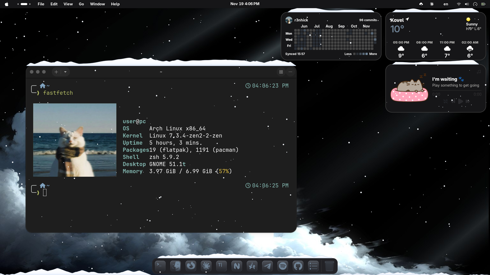

# Gnome-dots

My GNOME 51 setup on Arch Linux — dark, macOS‑Tahoe style, with snow ❄️



## What's inside

| | |
|---|---|
| **GTK / Shell theme** | `Tahoe-Soft` (dark, `prefer-dark`) → [`themes/`](themes) |
| **Icons** | [Tahoe icons](https://github.com/r3nhick/tahoe-icons) — `Tahoe-BlueGray` (inherits `Tahoe-Default` → `MacTahoe-dark`) → [`icons/`](icons) |
| **Cursors** | `Remus-White` → [`cursors/`](cursors) |
| **Wallpapers** | [`wallpapers/`](wallpapers) |
| **Window buttons** | left: `close, minimize, maximize` |
| **Settings** | dconf dumps → [`dconf/`](dconf) |

## My extensions

- ❄️ **[Snowcast](https://github.com/r3nhick/snowcast)** — snow falling over the desktop and piling up on windows
- 🧩 **[Desktop Widgets](https://github.com/r3nhick/desktop-widgets)** — GitHub contributions, weather, music player and other widgets on the desktop
- 🎨 **[Tahoe icons](https://github.com/r3nhick/tahoe-icons)** — the icon theme used here (`Tahoe-BlueGray`)

## Other extensions

All of them are in [`extensions/`](extensions) (copied from `~/.local/share/gnome-shell/extensions`).

| Extension | Source |
|---|---|
| Bluetooth Battery Meter | [link](https://github.com/maniacx/Bluetooth-Battery-Meter) |
| Coverflow Alt-Tab | [link](https://github.com/dsheeler/CoverflowAltTab) |
| Add to Desktop | [link](https://github.com/Tommimon/add-to-desktop) |
| App Volumes | [link](https://github.com/kapustota/gnome-app-volumes) |
| App Grid Uninstall | [link](https://github.com/i-soumya18/gnome-shell-appgrid-uninstall) |
| AppIndicator and KStatusNotifierItem Support | [link](https://github.com/ubuntu/gnome-shell-extension-appindicator) |
| Caffeine | [link](https://github.com/eonpatapon/gnome-shell-extension-caffeine) |
| Color Picker | [link](https://github.com/tuberry/color-picker) |
| Copyous | [link](https://github.com/boerdereinar/copyous) |
| Dash to Dock | [link](https://micheleg.github.io/dash-to-dock/) |
| Removable Drive Menu | [link](https://gitlab.gnome.org/GNOME/gnome-shell-extensions) |
| ESC to close Overview | [link](https://github.com/anatolyeltsov/gnome-ext-escape-to-close-overview) |
| Global Menu for GNOME | [link](https://github.com/ShiroOSL/global-menu-for-gnome) |
| Gtk4 Desktop Icons NG (DING) | [link](https://gitlab.com/smedius/desktop-icons-ng) |
| In Picture | [link](https://codeberg.org/filiprund/in-picture) |
| Isle | [link](https://github.com/zickrian/isle) |
| Just Perfection | [link](https://gitlab.gnome.org/jrahmatzadeh/just-perfection) |
| Kiwi Menu | [link](https://github.com/kem-a/kiwi-menu) |
| Notification Timeout | [link](https://github.com/vchlum/notification-timeout) |
| Desktop Shortcut | [link](https://github.com/nattesh/open-desktop-location) |
| Pin Window | [link](https://github.com/eltaweel068/pin-window) |
| Quick Exit | [link](https://github.com/baxyz/gnome-extensions) |
| User Avatar In Quick Settings | [link](https://github.com/d-go/quick-settings-avatar) |
| Shotzy | [link](https://github.com/SamkitJain660/Shotzy) |
| System Monitor | [link](https://gitlab.gnome.org/GNOME/gnome-shell-extensions) |
| User Themes | [link](https://gitlab.gnome.org/GNOME/gnome-shell-extensions) |
| Window Title Pro Topbar | [link](https://github.com/eprahemi/window-title-pro-topbar) |

## Install

```bash
git clone git@github.com:r3nhick/Gnome-dots.git
cd Gnome-dots
./install.sh
```

The script copies wallpapers, themes, icons, cursors and extensions into your home folder,
clones **snowcast** and **desktop-widgets** from GitHub, loads the dconf settings and enables the extensions.
Log out and back in afterwards.

Tools needed: `git`, `dconf`, `xz`, `python3`, `glib-compile-schemas`.

> ⚠️ `dconf load` overwrites the matching keys in your current settings — back them up first:
> `dconf dump / > ~/dconf-backup.ini`

### Icons only

Repo: **[r3nhick/tahoe-icons](https://github.com/r3nhick/tahoe-icons)**

A copy is also bundled here, split into parts because it is big:

```bash
cat icons/Tahoe-icons.tar.xz.part* | tar -xJf - -C ~/.icons
gsettings set org.gnome.desktop.interface icon-theme 'Tahoe-BlueGray'
```

`Tahoe-Default` falls back to `MacTahoe-dark` — get it from [vinceliuice/MacTahoe-icon-theme](https://github.com/vinceliuice/MacTahoe-icon-theme) if some icons are missing.

## Credits

Icons are based on MacTahoe / WhiteSur by [vinceliuice](https://github.com/vinceliuice). Extensions belong to their authors (see the table above).
